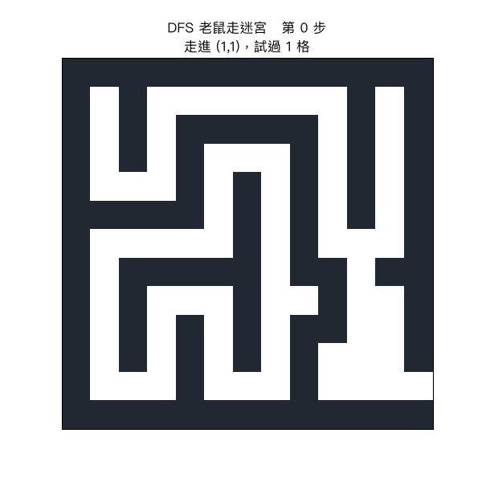

# 習題 1：老鼠走迷宮問題（DFS 深度優先搜尋）

程式：`1_rat_maze_dfs.py`（執行：`python3 1_rat_maze_dfs.py`）

## 動畫解說

執行 `python3 1_rat_maze_plot.py` 會重播 DFS 的每一步，動畫如下（可直接點開）：



### 怎麼看這段動畫？

| 顏色 | 意義 |
|------|------|
| 深色格 | 牆 `#` |
| 灰藍格 | **visited**：DFS 已探訪過的格子（踩過的痕跡會「留下來」） |
| 綠色格 | **現在手上這條路徑**（pop 時會縮回去） |
| 紅色格 | 動畫最後定格＝找到的完整路徑 |

三個值得盯著看的時刻：

1. **直線推進**：老鼠一路沿著「還沒走過」的方向深入——path 堆疊越長、綠色越多。
2. **撞死路**：走到盡頭後，畫面出現「死路 → 回溯」，**綠色突然縮回 1 格**——這就是 `path.pop()`。
3. **穿越**：回到岔路口換方向，繼續深入，最後衝出出口（33 次嘗試、路徑 28 格）。

從動畫可以清楚看出 DFS 的性格：**不回頭看全局，先拿到的路就走**——
途中踩過的灰格非常多，最後的紅色路徑卻只用其中一部分（至於是不是最短，DFS 不承諾）。

## 問題描述

一隻老鼠在迷宮中，從入口 `S` 走到出口 `E`，`#` 代表牆壁、`.` 代表可走的路。
老鼠只能上下左右移動，請找出一條可行走的路徑（不需要是最短路徑）。

## 搜尋法原理

### 狀態化（狀態、動作、目標）

| 要素 | 定義 |
|------|------|
| 狀態 | 座標 `(y, x)` |
| 起點 | 字元 `S` 的位置 |
| 目標 | 字元 `E` 的位置 |
| 動作 | 往上 / 下 / 左 / 右各走一步（穿牆不行） |
| 目標判斷 | 走到 `E` 那格就結束 |

### DFS（深度優先搜尋）的做法

```
函式 dfs(y, x):
    visited 標記這格；path.push(這格)          # 遞迴深入一層 = push
    這格是出口 → 回傳 True（沿遞迴逐層回傳，程式結束）
    依序嘗試四個鄰居：
        沒撞牆且沒走過 → dfs(鄰居)，成功就 return True
    path.pop()                                  # 死路 = pop（回溯）
    回傳 False
```

兩個關鍵：

1. **visited 訪問表**：讓同一格不走第二次，否則會在迷宮的迴圈上無限循環。
2. **path 路徑堆疊**：深入時 push、死路時 pop——這就是**回溯 (backtracking)**。

### 為什麼 DFS 不保證最短路？

DFS 只保證「找得到一條」，先試到哪條就走哪條（本例因試的方向順序，恰走 28 格）。
要最短路就得換策略：BFS（一層層擴散）或 A*（有方向感的擴散），
見習題 2、4。

## 執行報告

執行 `python3 1_rat_maze_dfs.py` 的完整輸出：

```text
=== 老鼠走迷宮 (DFS) ===

原始迷宮：

#############
#S#.......#.#
#.#.#####.#.#
#.#.#...#.#.#
#...#.#.#.#.#
#####.#.#.#.#
#.....#.#...#
#.#####.##.##
#.#...#..#..#
#.#.#.#.##..#
#.#.#.#.#...#
#...#...#...E
#############

找到路徑！長度 = 28 格，共嘗試 33 次

#############
#S#*******#.#
#*#*#####*#.#
#*#*#...#*#.#
#***#.#.#*#.#
#####.#.#*#.#
#.....#.#**.#
#.#####.##*##
#.#...#..#*.#
#.#.#.#.##*.#
#.#.#.#.#.*.#
#...#...#.**E
#############

路徑座標: (1, 1) -> (2, 1) -> (3, 1) -> (4, 1) -> (4, 2) -> (4, 3) -> (3, 3) -> (2, 3) -> (1, 3) -> (1, 4) -> (1, 5) -> (1, 6) -> (1, 7) -> (1, 8) -> (1, 9) -> (2, 9) -> (3, 9) -> (4, 9) -> (5, 9) -> (6, 9) -> (6, 10) -> (7, 10) -> (8, 10) -> (9, 10) -> (10, 10) -> (11, 10) -> (11, 11) -> (11, 12)
```

### 解讀

* `*` 就是被程式走出來的路徑。
* 13x13 迷宮中大約有 60 個可走格，DFS 實際只**嘗試 33 次**就碰到出口。
* 注意路徑一開始從 `S` 往左下繞、之後從右列直直下——DFS 是沿著「第一條沒被堵死的路」一路穿過去的。
