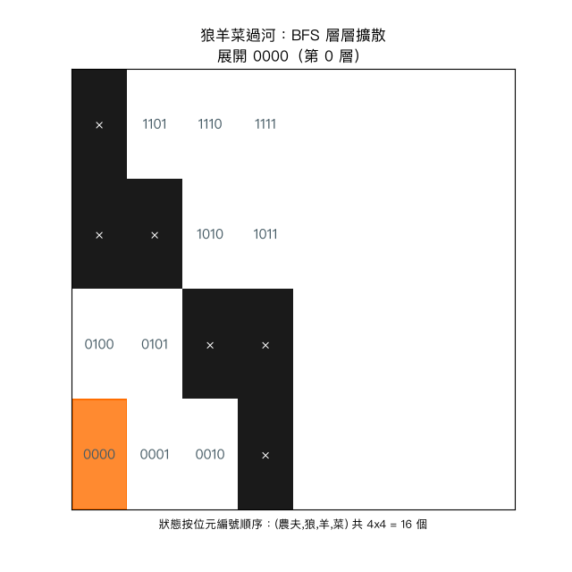

# 習題 2：狼羊甘藍菜過河問題（BFS 廣度優先搜尋）

程式：`2_wolf_sheep_cabbage_bfs.py`（執行：`python3 2_wolf_sheep_cabbage_bfs.py`）

## 動畫解說

執行 `python3 2_wolf_sheep_cabbage_bfs_plot.py` 會重播 BFS 層層展開的過程，動畫如下：



### 怎麼看這段動畫？

畫面把全部 **16 個狀態**排成 4x4 格（狀態四位元 `(農夫,狼,羊,菜)`）：

| 顏色 | 意義 |
|------|------|
| 黑格 × | 非法狀態（農夫不在場時羊狼或羊菜同岸）——BFS 根本不會踏進去 |
| 白格 | 還沒被 BFS 發現的狀態 |
| 藍色深淺 | 該狀態所處的**層數**（＝渡河次數；越深藍＝離起點越遠） |
| 橘框 | 這一刻正被展開的狀態 |
| 紅色外框（結尾） | 最短解路徑上的狀態 |

三個值得盯著看的時刻：

1. **第一層**：從 `0000` 出發，同時發現三、四個「農夫帶 X 過河」的鄰居——BFS 的特色是**一層一次擴一把**，不像 DFS 沿單路深走。
2. **非法格保持黑色**：整齣動畫顏色不會染到黑格上——拗不過約束的分支直接被剪掉。
3. **`1111` 亮紅**：目標在第 7 層被發現——因為 BFS 按層推進，「第一次碰到目標」的當下就知道是最少 7 次渡河，不需要再去比路徑長短。

## 問題描述

農夫要把狼、羊、甘藍菜運到河對岸。小船一次只能載農夫與一件物品。
沒有人看管時，**狼會吃羊、羊會吃菜**。請找出**最少渡河次數**的解。

## 搜尋法原理

### 狀態化（狀態、動作、目標）

| 要素 | 定義 |
|------|------|
| 狀態 | `(農夫, 狼, 羊, 菜)` 各為 0=左岸、1=右岸 |
| 狀態數 | 只有 2⁴ = 16 個 |
| 起點 | `(0, 0, 0, 0)` 全在左岸 |
| 目標 | `(1, 1, 1, 1)` 全在右岸 |
| 動作 | 農夫過河（翻轉自己的位元），可獨自走，或帶走一件「在他這邊」的物品 |
| 非法狀態 | 農夫不在場時，(羊+狼) 同岸 → 狼吃羊；(羊+菜) 同岸 → 羊吃菜 |

題目沒有格子、只有抽象條件，但「狀態 + 動作 + 目標」的搜尋框架照樣通用。
這也是為什麼慣例說「搜尋法不只會走迷宮，還能解規劃/謎題類問題」。

### BFS 的做法

```text
frontier = deque([起點])           # 待開發的狀態佇列（FIFO）
parent   = {起點: None}            # 前驅表（兼 visited）
while frontier 不空:
    state = frontier.popleft()     # FIFO：同一層先做完才進下一層
    state == 目標 → 用 parent 回溯重建路徑 → 此路為最短
    對每個合法動作生成 nxt → 沒來過且沒違反約束 → append 到佇列尾端
```

### 為什麼 BFS 保證「最少次數」？

BFS 依「層 (level)」展開：第 k 輪彈出的狀態，距起點恰是 k 次渡河。
所以**第一次**彈出目標狀態的那個時刻，路徑長度就是最少步數。
DFS 可能先沿一條很繞的路走，BFS 不會。

### 與其他策略的選擇理由

* 用 DFS？→ 一樣能找到解，但不保證最少；還得靠 visited 兜底避免死循環。
* 用 A*？→ 可以做，但整個狀態圖只有 16 格，BFS 就是最乾淨、最直接的答案。
* 用一個 `parent` 字典「前驅 + visited」兩用，是狀態圖搜尋的常用技巧。

## 執行報告

執行 `python3 2_wolf_sheep_cabbage_bfs.py` 的完整輸出：

```text
=== 狼羊菜過河 (BFS) ===

起點 = (0,0,0,0) 全在左岸

最少渡河 7 次：
  農夫帶著羊過河到右岸   狀態 = (1, 0, 1, 0)
  農夫單獨過河到左岸   狀態 = (0, 0, 1, 0)
  農夫帶著狼過河到右岸   狀態 = (1, 1, 1, 0)
  農夫帶著羊過河到左岸   狀態 = (0, 1, 0, 0)
  農夫帶著菜過河到右岸   狀態 = (1, 1, 0, 1)
  農夫單獨過河到左岸   狀態 = (0, 1, 0, 1)
  農夫帶著羊過河到右岸   狀態 = (1, 1, 1, 1)
```

### 解讀

* **最少 7 次渡河**，這是此問題的公認最佳解。
* 第 4 行「把羊又載回來」是解的靈魂：搜尋法不在乎人腦直覺，只在乎狀態轉移合法。
* 整個搜尋只在 16 個狀態上進行（其中 6 個因「狼羊」或「羊菜」同岸而非法），
  BFS 實際拜訪的狀態遠少於 16，跑起來零負擔。
