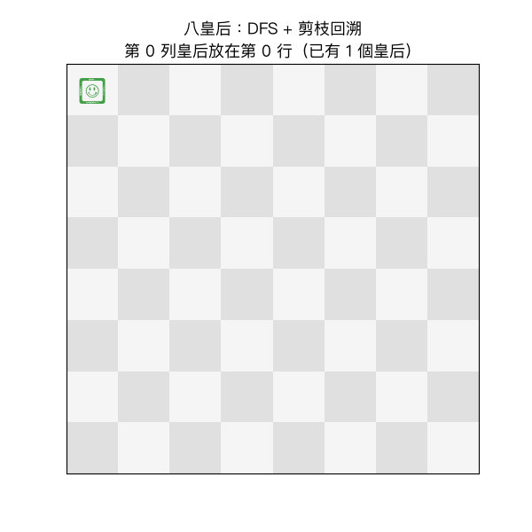

# 習題 3：八皇后問題（DFS + 剪枝 ＝ 回溯法）

程式：`3_nqueens_dfs.py`（執行：`python3 3_nqueens_dfs.py`）

## 動畫解說

執行 `python3 3_nqueens_plot.py` 會重播回溯法「放皇后 → 衝突 → 撤掉」的過程，動畫如下：



### 怎麼看這段動畫？

| 顏色 | 意義 |
|------|------|
| 綠 ♛ | 目前路徑上已放好的皇后（只到某一列為止） |
| 紅 ✕ | 這一格剛被剪枝偵測到衝突，**根本不會遞迴進去** |
| 標題文字 | 說明此刻在放 / 剪 / 撤哪一格 |

三個值得盯著看的時刻：

1. **一路順風**：前幾列皇后很順利排下去（0→4→7→5→2），綠色快速增加。
2. **卡住與回撤**：某列 8 個行全都是 ✕（前面皇后把整列攻擊覆蓋完）時，
   畫面出現**上方皇后的撤掉**與標題「回溯」——綠 ♛ 減少一排，這是回溯法的瞬間。
3. **轉折到解**：回撤后換行的皇后位置，讓下一列立即有合法格，最後第 8 列放好 → 出現第一組解 `[0,4,7,5,2,6,1,3]`。

從動畫可以感受到「剪枝」的力量：大量紅 ✕ 代表**被擋在門外的分支**。
如果沒剪枝，這些分支都會被遞迴展開搜完（8⁸ 種）；有剪枝只剩 982 步就走到第一個解、
全部展開也僅 15,720 多次分支嘗試就能數完 92 組解。

## 問題描述

在 8x8 棋盤上放 8 個皇后，使得任何兩個皇后**不能在同一列、同一行、或同一條對角線上**（即不能互相攻擊）。問有幾種放法？

這是一道經典的「**回溯法 (Backtracking)**」教科書題目——回溯法就是「會剪枝的 DFS」。

## 搜尋法原理

### 狀態化（狀態、動作、目標）

一列放恰好一個皇后，所以狀態可以寫成：

```text
queens[r] = c    # 第 r 列的皇后放在第 c 行
```

| 要素 | 定義 |
|------|------|
| 狀態 | 前 k 列的行號序列 `queens[0..k-1]` |
| 起點 | 空序列 |
| 目標 | 放滿 8 列且中間從未互相攻擊 |
| 動作 | 在第 k 列的 8 個行各試一次 |

### 約束檢查：同行／主對角線／反對角線

把新皇后放到 `(row, col)` 時，要和前面每一個 `(r, queens[r])` 比：

```text
同行             ：queens[r] == col
主對角線（↘）    ：r - queens[r] == row - col
反對角線（↗）     ：r + queens[r] == row + col
```

實作上把兩條對角線一行寫成 `abs(r - row) == abs(queens[r] - col)`。

### 剪枝（Pruning）的威力

* **不剪枝**：所有放法是 8⁸ ≈ **1677 萬**種「每列放一個皇后」的組合要數。
* **有剪枝**：放下去「馬上會被打」的分支直接 `continue`，不遞迴進去。
  → 只需搜尋「安全前置」的那一小部分狀態樹，就能**一道不少地**找出全部 92 組解。

剪枝不改變 DFS 的骨架，只是讓沒希望的分支提早斷掉，兩者是搭配，不是二選一。

### DFS + 剪枝的骨架（程式核心）

```python
def dfs(row=0):
    if row == N:                      # 放滿 8 列 → 收集解答
        solutions.append(queens[:])
        return
    for col in range(N):
        if conflict(row, col):
            continue                  # 剪枝：這格不行，換下一行
        queens.append(col)            # 選擇：放皇后
        dfs(row + 1)                  # 往下一層走
        queens.pop()                  # 撤銷（回溯）：換下一行再試
```

### 為什麼要「全部解」而不只要一個？

八皇后的題目問「有幾種」；DFS + 剪枝全展開後，解的數量就是答案（92 組）。
若題目只要一組解，找到第一組就 return 即可（這是 DFS 的「找得到」優點）。

## 執行報告

執行 `python3 3_nqueens_dfs.py` 的完整輸出（前 3 組解附棋盤，後 89 組只列行號序列）：

```text
=== 八皇后 (DFS + 回溯) ===
共找到 92 組解（理論值 92）

解 1：行號序列 = [0, 4, 7, 5, 2, 6, 1, 3]
   Q . . . . . . .
   . . . . Q . . .
   . . . . . . . Q
   . . . . . Q . .
   . . Q . . . . .
   . . . . . . Q .
   . Q . . . . . .
   . . . Q . . . .

解 2：行號序列 = [0, 5, 7, 2, 6, 3, 1, 4]
   Q . . . . . . .
   . . . . . Q . .
   . . . . . . . Q
   . . Q . . . . .
   . . . . . . Q .
   . . . Q . . . .
   . Q . . . . . .
   . . . . Q . . .

解 3：行號序列 = [0, 6, 3, 5, 7, 1, 4, 2]
   Q . . . . . . .
   . . . . . . Q .
   . . . Q . . . .
   . . . . . Q . .
   . . . . . . . Q
   . Q . . . . . .
   . . . . Q . . .
   . . Q . . . . .

解 4：行號序列 = [0, 6, 4, 7, 1, 3, 5, 2]
解 5：行號序列 = [1, 3, 5, 7, 2, 0, 6, 4]
解 6：行號序列 = [1, 4, 6, 0, 2, 7, 5, 3]
...
解 92：行號序列 = [7, 3, 0, 2, 5, 1, 6, 4]
```

### 解讀

* 共 **92 組解**，與理論值完全相同。
* 解 1 的第一列皇后放在 col 0（最角落）：DFS 從第一支分支一路挖到了答案。
* N 皇后中 N=2、3 無解；N>3 都是可解的，所以 8 是最小的「非平凡」例子。
