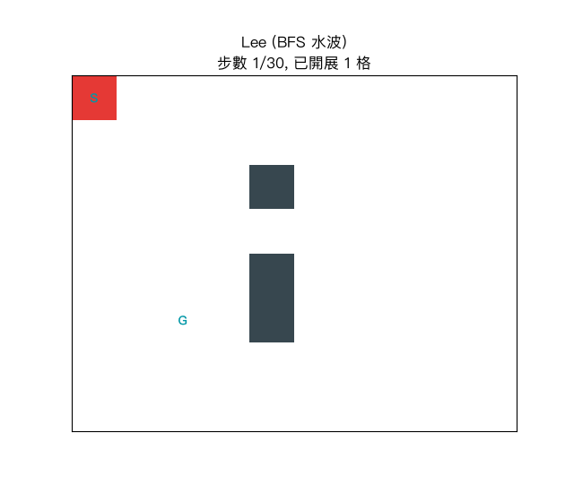

# 習題 5：IC 設計中的電路繞線問題（Lee / Hadlock / A*）

程式：`5_ic_routing.py`（執行：`python3 5_ic_routing.py`）

## 動畫解說

執行 `python3 5_ic_routing_plot.py` 會讓三種波前**依序上場**接同一條 net
`(0,0) → (5,2)`，動畫如下：



### 怎麼看這段動畫？

畫面分三段（標題會顯示當前方法與步數）：

| 顏色 | 意義 |
|------|------|
| 深色格 | 已被佔用的障礙 `#` |
| 青→深藍色階 | **開展順序**：越淺越早展開（＝水波擴散的「波跡」） |
| 紅框格 | 這一刻正被彈出/擴展的格子 |
| 綠色格 | 該方法收工時亮出的最短繞線 |

三段對比看的重點：

1. **Lee（BFS 水波）**：波前向上下左右**均勻**擴散成圓圈圈，最後才爬到目標——共開展 30 格。
2. **Hadlock（detour 0/1 BFS）**：波前**只沿目標方向排隊前進**，逆行格被丟到隊尾慢慢才碰——同樣最短（7 格線），但只開展 8 格！
3. **A*（g + h）**：波前像探照燈一樣**聚焦在朝目標的方向**，開展 18 格，界於 Lee 與 Hadlock 之間。

三個方法找到的線一樣是長度 7 的最短繞線——**差別只在「浪費了多少格去試」**，
這正是繞線器挑搜尋法時最現實的考量（大晶片上格數是好幾百萬，開展就是時間）。

## 問題描述

晶片內部的金屬布線層可以想成一片二維格子，每格叫一個 cell。
繞線 (routing) 就是把每一組「接腳 ↔ 接腳」（稱為一條 **net**）
用一條格子路徑連起來，而且**多條 net 不能共用同一格**。

本程式在 8x10 格子上（中間有三個 `#` 障礙）逐一繞兩條 net：

```text
net 1（A）：接腳 (0,0) → 接腳 (5,2)
net 2（B）：接腳 (0,9) → 接腳 (5,7)
```

## 搜尋法原理

### 繞線的工程策略：逐條繞 + 擋牆 (blockage)

```text
for 每條 net:
    用「單源格子搜尋法」找一條最短線路
    （已繞過的 net 走過格都當成障礙，但其他 net 的接腳要保留）
    把線路畫上去；下一條 net 就會被它擋住
```

真實 EDA 工具還會再做：net ordering（排序決定先後）、
rip-up & reroute（繞不通就撕掉重繞）、多層金屬改 3D 搜尋、cost 調權重等。

### 方法 1：Lee 演算法（BFS 水波繞線，1961）

* 從起點像水波一樣一圈圈往外淹 (wavefront)，碰目標即回溯。
* 每步成本全部當作 1 → 保證最短線路。
* 缺點：會淹掉幾乎整張圖才找到，最慢。

### 方法 2：Hadlock 演算法（0/1 BFS + detour number）

* 記每個格子「到目前為止多繞了幾步」(detour number)：
  * 下一步**比現在更靠近目標** → detour 不加（成本 0，放 deque 前頭）
  * 下一步**逆著目標方向** → detour +1（成本 1，放 deque 後尾）
* 這叫 **0/1 BFS**：權重只有 0 與 1 時可以用 deque 取代 priority queue，
  且仍找到了「detour 最少」的路——而 detour 最少 ⇔ 線路總長最短。
* 實測比 Lee 少開展很多格，這正是 1970 年代繞線器對 Lee 的著名改良。

### 方法 3：A* 繞線（現代工具的祖先）

* `f(n) = g(n) + h(n)`，h 用曼哈頓距離。
* 有方向感，開展量比 Lee 少；工業繞線器（如 maze router）都以此為骨架。

### 三法在這張圖上的實測

| 方法 | 每步成本 | 兩條 net 合計開展格數 | 特點 |
|------|---------|------------------|------|
| Lee | 全部 = 1 | 61 | 保證最短，但幾乎淹爆全圖 |
| Hadlock | 直行 0、逆目標 1 | 16 | detour 計數：最快，路一樣最短 |
| A* | f = g+h | 36 | 有方向感，工業工具的祖師 |

**三法都找到長度 7 的最短線**，差別只在「花多少格才知道答案」。

## 執行報告

執行 `python3 5_ic_routing.py` 的完整輸出：

```text
=== IC 電路繞線：Lee / Hadlock / A* ===

原始格子圖（# = 佔用障礙）：

A . . . . . . . . B
. . . . . . . . . .
. . . . # . . . . .
. . . . . . . . . .
. . . . # . . . . .
. . A . # . . B . .
. . . . . . . . . .
. . . . . . . . . .

--- 方法 1：Lee 演算法（BFS 水波繞線） ---
  net (0, 0) -> (5, 2)  長度 = 7，開展 30 格
  net (0, 9) -> (5, 7)  長度 = 7，開展 31 格

A . . . . . . . . B
1 . . . . . . . . 2
1 . . . # . . . . 2
1 . . . . . . . . 2
1 . . . # . . . . 2
1 1 A . # . . B 2 2
. . . . . . . . . .
. . . . . . . . . .
  （方法 1：Lee 演算法（BFS 水波繞線） 兩條 net 合計開展 61 格）

--- 方法 2：Hadlock 演算法（detour 0/1 BFS） ---
  net (0, 0) -> (5, 2)  長度 = 7，開展 8 格
  net (0, 9) -> (5, 7)  長度 = 7，開展 8 格

A 1 1 . . . . 2 2 B
. . 1 . . . . 2 . .
. . 1 . # . . 2 . .
. . 1 . . . . 2 . .
. . 1 . # . . 2 . .
. . A . # . . B . .
. . . . . . . . . .

--- 方法 3：A* 繞線（g + 曼哈頓 h） ---
  net (0, 0) -> (5, 2)  長度 = 7，開展 18 格
  net (0, 9) -> (5, 7)  長度 = 7，開展 18 格

A 1 1 . . . . 2 2 B
. . 1 . . . . 2 . .
. . 1 . # . . 2 . .
. . 1 . . . . 2 . .
. . 1 . # . . 2 . .
. . A . # . . B . .
. . . . . . . . . .
. . . . . . . . . .
  （方法 3：A* 繞線（g + 曼哈頓 h） 兩條 net 合計開展 36 格）
```

### 解讀

* 兩條 net 的線路長度都是 7 格；`1`/`2` 與 `A`/`B` 分別是兩條 net 的線與接腳。
* 兩條 net 各有兩種「等長」走法：Lee 沿左／右邊界一條路直下，
  Hadlock 和 A* 則先沿上緣橫行再轉直下——最短路不唯一，但長度都一樣。
* Hadlock 合計只開展 **16 格**、Lee 要 **61 格**——在 8x10 小圖就差 4 倍，
  這正是 Lee 演算法在大晶片「淹爆格子」而被後人改良的原因。
* 三法都是迷宮搜尋：差別不在「能不能找到」，而在**先去看哪一格**（開展順序）。

## 五種方法縮到一起看的共同框架

```text
frontier（stack / queue / deque / heap） + visited + parent
        ↑ 開展策略       ↑      ↑       ↘ 前驅重建路徑
```

五題程式其實都長這樣——差別只在 frontier 怎麼排序：
stack（DFS）、queue（BFS / Lee）、heap（A*）、deque 忙 0/1 排序（Hadlock）。

---

## 延伸：現代方法與 SOTA

這三種是「單條 net 的迷宮搜尋」；真實工具在此之上還有
**線搜尋（Soukup）、Steiner 樹拓撲（FLUTE）、可協商擠塞繞線（PathFinder）、
強化學習繞線（DeepPR / PRNet 一族的示意）**等現代做法，
以及 2023-2026 年的 SOTA 全景（GPU 平行化、可微繞線、LLM 輔助調參）。

→ 續讀 [5_ic_routing_modern.md](5_ic_routing_modern.md)（附 `5_ic_routing_modern.py` 四種方法的實作與執行報告）。
