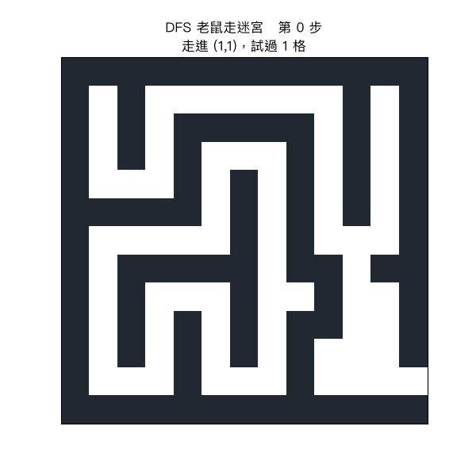
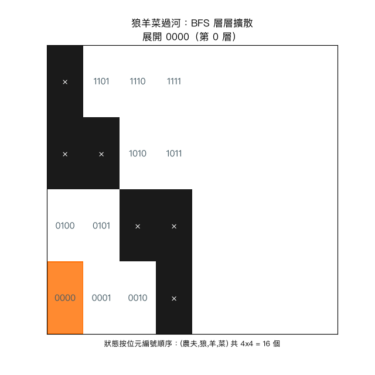
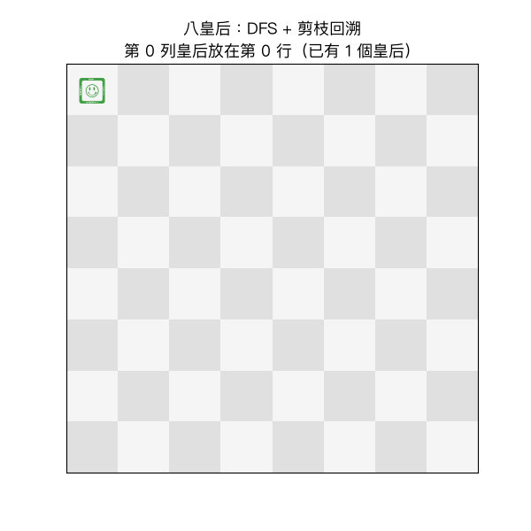
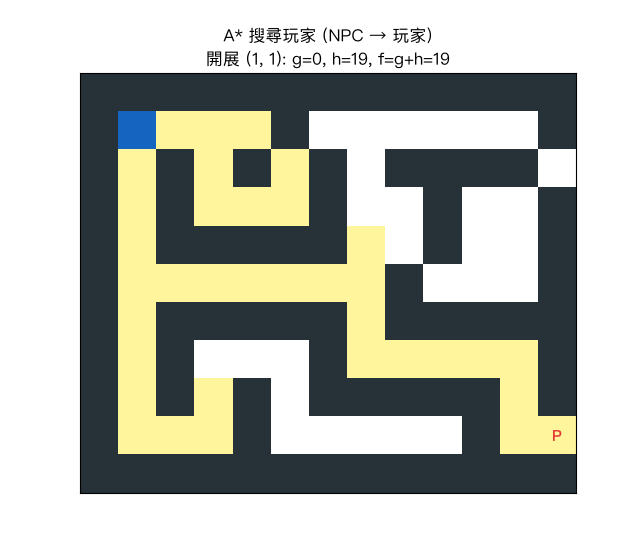
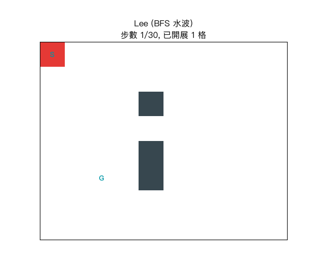
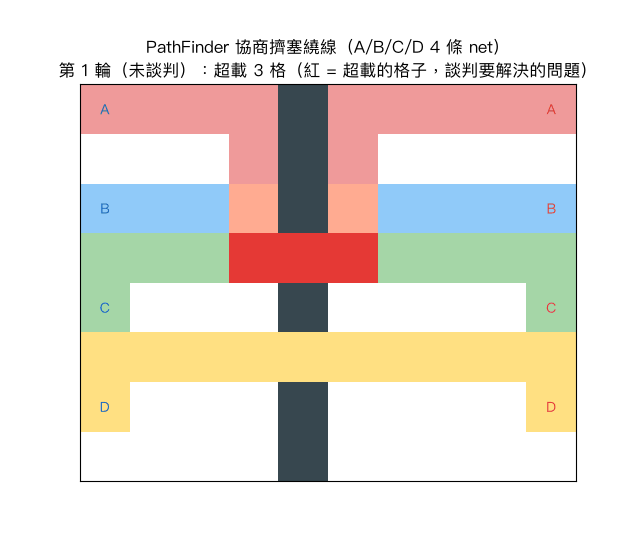

# Week 9 作業：用「搜尋法」解決五個經典問題

陳鍾誠《演算法》115 學年下學期，搜尋法習題實作。

搜尋法 (Search) 的共同心法，是把問題化成一張**狀態圖 State Graph**：

```
    起點 --[動作/開展]--> 新狀態 --[動作/開展]--> ... --> 目標狀態
```

只要定義清楚「**狀態是什麼**、**動作有哪些**、**目標怎麼判斷**」，
程式就完成了 80%；剩下的差別只在「**用什麼策略決定下一次展開哪個狀態**」。
本作業五題分別用了 DFS、BFS、DFS+剪枝（回溯法）、A*，以及三種 IC 繞線搜尋法。

## 檔案一覽

| 檔案 | 問題 | 搜尋法 | 說明文件 |
|------|------|--------|----------|
| `1_rat_maze_dfs.py` | 老鼠走迷宮 | DFS + 回溯 | [1_rat_maze_dfs.md](1_rat_maze_dfs.md) |
| `2_wolf_sheep_cabbage_bfs.py` | 狼羊甘藍菜過河 | BFS（層次擴散） | [2_wolf_sheep_cabbage_bfs.md](2_wolf_sheep_cabbage_bfs.md) |
| `3_nqueens_dfs.py` | 八皇后 | DFS + 剪枝（回溯法） | [3_nqueens_dfs.md](3_nqueens_dfs.md) |
| `4_npc_astar_player.py` | NPC 找玩家（遊戲尋路） | A*（g + 曼哈頓 h） | [4_npc_astar_player.md](4_npc_astar_player.md) |
| `5_ic_routing.py` | IC 電路繞線 | Lee / Hadlock / A* | [5_ic_routing.md](5_ic_routing.md) |
| `5_ic_routing_modern.py` | IC 繞線（現代進階） | 線搜尋 / Steiner 樹 / PathFinder / RL | [5_ic_routing_modern.md](5_ic_routing_modern.md) |

每支程式執行：`python3 xxx.py`；原理與執行報告都在對應的 `xxx.md` 裡。

## 搜尋過程的動畫

每題都有一支 `xxx_plot.py`：把演算法「錄影」下來重播（matplotlib 動畫），
執行完會自動把動畫存成 `<名稱>.gif`。以下 gif 可直接點開播放；
各題的配色說明與「值得盯著看的時刻」詳見對應的 `xxx.md`。

### 1. 老鼠走迷宮（DFS）



灰藍格＝已探訪（visited）、綠格＝當前路徑、紅色＝最終路徑；
動畫能清楚看到「走到底 → 撞牆 → path 縮回去（回溯）」的節奏。

### 2. 狼羊菜過河（BFS）



4x4 格 = 全部 16 個渡河狀態；黑色 = 非法狀態、藍色深淺 = 發現的層數、
紅框 = 最短解徑。BFS「一層一次染一把」的擴散感和黑色格的約束剪除一目瞭然。

### 3. 八皇后（DFS + 剪枝）



綠 ♛ = 已放好的皇后、紅 ✕ = 被剪枝擋掉的衝突格；
卡住時可以看到皇后「被撤掉」的瞬間——回溯法的靈魂。

### 4. NPC 搜尋玩家（A*）



黃格 = frontier（排隊中的候選）、藍格 = closed（已開展）、
標題顯示每次開展的 g / h / f 值；波前明顯朝玩家方向蔓延，只開展 33 格（BFS 要 54）。

### 5. IC 繞線：Lee / Hadlock / A* 三種波前



三段畫面依序展演同一條 net：青→深藍色階 = 開展順序、綠 = 找到的最短繞線；
三法都得到長度 7 的最短解，開展格數卻是 30 / 8 / 18——差的是「試錯的成本」。

### 6. IC 繞線：PathFinder 談判 + Q-learning 學習



前半：PathFinder 第 1 輪所有 net 都想走最短路（紅格 = 超載），漲價談判後
第 2 輪就溝出「兩條 net 分用兩條通道」的合法解；後半：Q-learning 學好的
policy 貪心走出 16 步 = BFS 最短。

<!-- 上述動畫的產生方式：
需要依賴：pip3 install --break-system-packages matplotlib pillow
共用模組 _plot_common.py 會自動找系統中的中文字型（PingFang TC 等）。
每一支 xxx_plot.py 在無螢幕環境下也可執行：
MPLBACKEND=Agg python3 xxx_plot.py   # 只輸出 gif、不開視窗
-->

## 搜尋策略總覽

| 策略 | 開展順序 | 保證最短？ | 適用情境 |
|------|----------|-----------|----------|
| DFS | 沿一條支路走到底（遞迴/堆疊） | 否 | 迷宮、可解性判定（找得到就行） |
| 回溯法 | DFS + 死路退一步 + 剪枝 | 是（解的完整與正確性） | 八皇后、組合問題 |
| BFS | 一層一層（FIFO 佇列） | 是（等權重圖上） | 過河、最少步數 |
| A* | 挑 f(n)=g(n)+h(n) 最小者 | 是（h 不高估時） | 遊戲尋路、地圖導航 |
| Lee 演算法 | BFS 水波 | 是 | IC 繞線 |
| Hadlock 演算法 | 0/1 BFS（依 detour 排序） | 是 | IC 繞線（更快） |

---

## 1. 老鼠走迷宮（DFS）

### 狀態化

* **狀態**：座標 `(y, x)`；**起點**：`S`；**目標**：`E`
* **動作**：上下左右各走一步（不能穿 `#`）
* **目標判斷**：走到 `E` 即結束

### DFS 怎麼做？

```text
函式 dfs(y, x):
    visited 標記這格；path.push(這格)          # 遞迴深入 = push
    這格是出口 → 回傳 True（沿遞迴逐層回傳所以程式結束）
    依序試四個鄰居：
        沒撞牆且沒走過 → dfs(鄰居)，成功就 return True
    path.pop()                                  # 死路 = pop（回溯）
    回傳 False
```

兩個重點：

1. `visited` 讓同一格不走第二次，否則會繞圈圈無限循環。
2. `path` 是現在這條路的堆疊：深入時 push、死路時 pop——這就是回溯 (backtracking)。

### 為什麼不是最短路？

DFS 只保證「找得到一條」，先試到哪條就走哪條。要最短路請用 BFS 或 A*（見第 4 題）。

### 執行結果範例

```text
找到路徑！長度 = 28 格，共嘗試 33 次

#############
#S#*******#.#      ← * 就是 DFS 找到的那一條路
...（完整棋盤見執行輸出）
```

---

## 2. 狼羊甘藍菜過河（BFS）

### 狀態化

* **狀態**：`(農夫, 狼, 羊, 菜)` 各為 0=左岸、1=右岸 → 只有 2⁴=16 個狀態
* **起點** `(0,0,0,0)`、**目標** `(1,1,1,1)`
* **動作**：農夫過河，可獨自走或帶走一件「在他這邊」的物品
* **約束**：農夫不在場時，羊不能和狼同岸、羊不能和菜同岸

題目沒有格子、只有抽象條件，但「狀態 + 動作 + 目標」的語法照樣通用。

### BFS 怎麼做？

```text
frontier = 佇列，先放入起點
parent  = 前驅字典（兼 visited）
while frontier 不空:
    state = frontier.popleft()         # FIFO：同一層先做完才進下一層
    state == 目標 → 用 parent 回溯重建路徑 → 這條路一定最短
    對每個合法動作生成 nxt → 沒來過且合法 → append到佇列尾端
```

BFS 的保證：依「層數」就是「步數」對映，第一次彈出目標時一定是最少步。

### 執行結果（最少 7 次渡河）

```text
農夫帶著羊過河到右岸   狀態 = (1, 0, 1, 0)
農夫單獨過河到左岸   狀態 = (0, 0, 1, 0)
農夫帶著狼過河到右岸   狀態 = (1, 1, 1, 0)
農夫帶著羊過河到左岸   狀態 = (0, 1, 0, 0)  ← 關鍵一步：把羊又載回來
農夫帶著菜過河到右岸   狀態 = (1, 1, 0, 1)
農夫單獨過河到左岸   狀態 = (0, 1, 0, 1)
農夫帶著羊過河到右岸   狀態 = (1, 1, 1, 1)
```

人腦常在「羊載過去又載回來」這步卡住；BFS 根本不在乎直覺，照樣找出最短解。

---

## 3. 八皇后（DFS + 剪枝 = 回溯法）

### 狀態化

* 一列放一個皇后 → 狀態就是 `queens[r] = c`（第 r 列皇后放在第 c 行）
* **動作**：在下一列 8 個行各試一次
* **約束**：同行 / 主對角線 / 反對角線不能有兩個皇后

```text
同行     ：queens[i] == col
兩種對角線：abs(i - row) == abs(queens[i] - col)
```

### 剪枝（Pruning）多重要？

* 不剪枝：所有放法 8⁸ ≈ 1677 萬種都要數
* 有剪枝：放下去「馬上會被打」的分支直接不遞迴 → 只搜「很少」的狀態樹，卻一道不少地找出全部 92 組解

### DFS + 剪枝的骨架

```text
dfs(row):
    row == N → 記下這組解
    for col in 0..N-1:
        若和前面的皇后互相攻擊 → continue   # 剪枝！
        這格放皇后 → dfs(row+1)  → pop（回溯，換 col 再試）
```

### 執行結果

```text
共找到 92 組解（理論值 92）

解 1：行號序列 = [0, 4, 7, 5, 2, 6, 1, 3]
   Q . . . . . . .
   . . . . Q . . .
   ...
```

---

## 4. NPC 搜尋玩家（A*）

### 問題

遊戲地圖上 NPC 要穿過障礙物，用最少步數走到玩家所在的位置。
這是遊戲 AI 每一幀都在做的 pathfinding (尋路)。

### A* = BFS 的聰明版

A* 替每個待開展的格子算一個綜合評分：

```text
f(n) = g(n) + h(n)
        ↑         ↑
   起點到 n 的    猜估 n 到目標還要
   實際成本       多遠（這裡用曼哈頓距離）
```

用 priority queue（heapq），每次挑 f 最小者開展。
h 只要「保守」（永不高估真實剩餘成本），A* 就保證找到最短路。

### DFS / BFS / A* 在同一張地圖的實測比較

```text
A* 開展 33 格 vs BFS 開展 54 格   ← 靠啟發函數省下近一半的計算
兩者都找到 19 步最短路；DFS 根本不保證最短
```

### 執行結果範例

```text
#############
#N...#......#
#*#.#.#.####.
...
#*******#...#
#.#####*#####
#.#...#*****#
...（完整棋盤見執行輸出）
```

---

## 5. IC 電路繞線（Lee / Hadlock / A*）

### 問題

晶片內的金屬層可視為二維格子，每條 net 要把兩個接腳連起來，
且**多條 net 不能共用同一格**——這是「迷宮尋路 + 逐條繪製」的工業版。

### 繞線策略：逐條繞 + 擋牆 (blockage)

```text
for 每條 net:
    用單源搜尋法在格子圖上找一條最短線路
    （其他 net 已繞的格子常成為障礙）
    畫上去；下一條 net 就被這條擋住
```

真實 EDA 工具還會做：net ordering 排序、失敗 rip-up & reroute（撕掉重繞）、
用多層金屬改 3D 搜尋、cost 調權重……核心仍然是同一套搜尋框架。

### 三種格子搜尋法（同一張 8x10 棋盤、兩條 net 實測）

| 方法 | 每步成本 | 合計開展格數 | 特點 |
|------|----------|-----------|------|
| Lee（BFS 水波） | 全部 = 1 | 61 | 保證最短，但幾乎會淹過整張圖 |
| Hadlock（0/1 BFS） | 直行 0、逆目標 1 | 16 | detour 計數：只往「反向」才加 1；路徑一樣最短 |
| A*（g + 曼哈頓 h） | f = g + h | 36 | 有方向感、工業工具的祖先 |

三種方法都找到長度 7 的最短線路，差別只在**要開展多少個格子才知道答案**。

```text
--- 方法 2：Hadlock ---
A 1 1 . . . . 2 2 B
. . 1 . . . . 2 . .
. . 1 . # . . 2 . .
. . 1 . . . . 2 . .
. . 1 . # . . 2 . .
. . A . # . . B . .
```

---

## 五題共同的收穫

1. **先把問題翻譯成（狀態、動作、目標）三元組**——解法自然浮現。
2. **要求的答案不同，策略就不同**：有解就行（DFS）；要最短步（BFS / A*）；要全部解（回溯法）。
3. **剪枝與啟發函數**是效率的分水嶺：好的約束檢查與好的 h 能省下十倍以上的搜尋。
4. 這五個程式其實都是同一套樣板：`frontier + visited + parent`，
   差別只在 frontier 用 stack（DFS）、queue（BFS / Lee）、還是 heap（A* / Hadlock 的 deque）。
